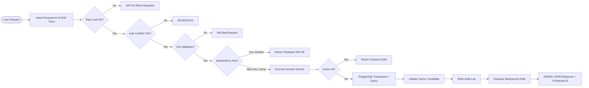
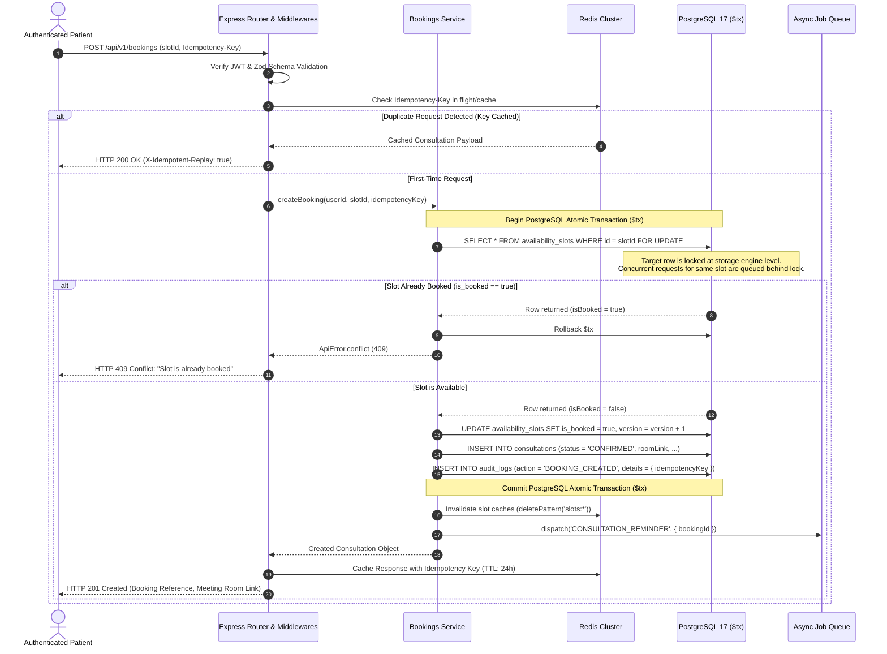
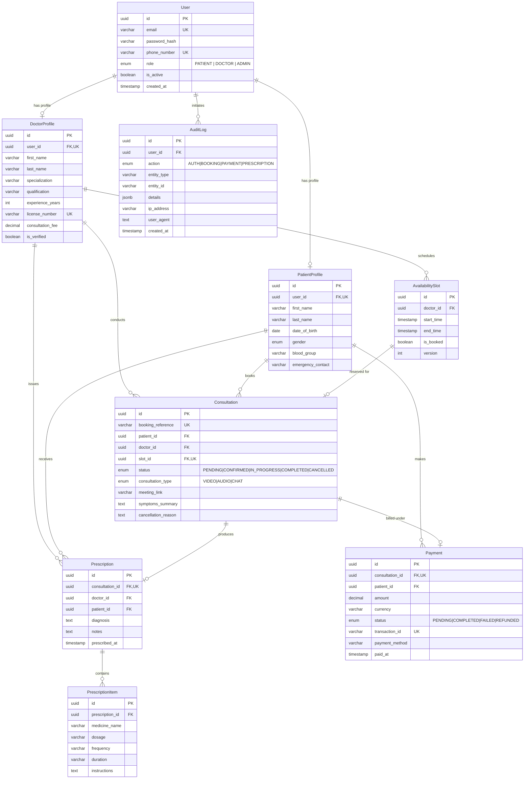

# Amrutam Telemedicine Backend - Architecture & System Design Document

**Scale Target**: 100,000 Daily Consultations  
**Latency Budget**: p95 < 200ms (Reads), p95 < 500ms (Writes)  
**System Availability**: 99.95% (<= 4.38 hours downtime/year)  
**Security & Compliance**: RBAC, PHI Data Protection, DISHA/HIPAA Principles  

---

## 1. High-Level Architecture & Data Flow

The Amrutam Telemedicine Platform is structured as a **Clean, Modular Monolith** with stateless horizontal autoscaling behind an Application Load Balancer. It isolates domain boundaries while avoiding premature distributed microservice overhead.

### A. System Architecture Diagram
```mermaid
graph TD
    Client["Clients (Web / iOS / Android)"] -->|HTTPS / TLS 1.3| ALB["Application Load Balancer (AWS ALB / WAF)"]
    
    subgraph Compute ["Stateless App Cluster (Node.js 22 + Express)"]
        ALB --> Pod1["Node.js Pod 1"]
        ALB --> Pod2["Node.js Pod 2"]
        ALB --> PodN["Node.js Pod N (Auto-scaled)"]
        
        subgraph Pipeline ["Middleware & Domain Pipeline"]
            MW["Trace (W3C traceparent) & X-Request-Id"]
            RL["Rate Limiters (Global & Auth)"]
            Idemp["Idempotency Interceptor"]
            Ctrl["Thin Controllers & Zod Validation"]
            Svc["Domain Services (Auth, Doctor, Booking, Rx, Payment)"]
            
            MW --> RL --> Idemp --> Ctrl --> Svc
        end
    end

    subgraph DataTier ["Data & Caching Tier"]
        Svc -->|Pessimistic Row Lock & ACID $tx| PrimaryDB[("PostgreSQL Primary (Multi-AZ Write)")]
        PrimaryDB -.->|Synchronous Replication| StandbyDB[("PostgreSQL Standby (AZ 2)")]
        PrimaryDB -.->|Read Streaming| ReadReplica[("PostgreSQL Read Replicas")]
        Svc -->|Read Queries (Fallback)| ReadReplica
        
        Svc -->|Cache & JWT Blacklist| RedisCluster[("Redis Cluster (Sentinel / In-Memory)")]
    end

    subgraph AsyncTier ["Asynchronous & Observability Tier"]
        Svc -->|Dispatch Async Tasks| JobQueue["In-Memory / BullMQ Job Queue"]
        JobQueue --> Notifications["SMS / Email Notification Worker"]
        JobQueue --> PDFWorker["Prescription PDF Generator"]
        
        Pod1 -->|Scrape Metrics| Prometheus["Prometheus Server (/metrics)"]
        Pod1 -->|Structured JSON Logs| LogAggregator["CloudWatch / ELK Stack"]
    end
```

### B. Request Data-Flow Diagram


### C. Data Flow Execution Model
1. **Client Ingestion**: Requests arrive at the ALB with strict TLS termination and WAF filtering (mitigating SQLi, XSS, and DDoS).
2. **Perimeter Middleware Pipeline**:
   - `requestId`: Attaches a cryptographically unique `X-Request-Id` UUIDv4 and W3C `traceparent`.
   - `metricsMiddleware`: Records duration histograms and counters for Prometheus exposition at `/metrics`.
   - `apiRateLimiter` & `authRateLimiter`: Sliding-window memory/Redis rate limiters.
   - `idempotency`: Intercepts write requests (`POST /api/v1/bookings`, `POST /api/v1/payments/process`) carrying `Idempotency-Key` headers to ensure atomic exactly-once execution.
3. **Thin Controllers & Domain Services**: Express controllers parse parameters, enforce Zod schemas, and delegate business logic to isolated domain services (`auth`, `doctors`, `bookings`, `prescriptions`, `payments`, `admin`).
4. **Data Persistence**:
   - Write mutations run inside PostgreSQL transactions (`prisma.$transaction`) with pessimistic row locking (`SELECT ... FOR UPDATE`).
   - Read queries hit Redis cache layers with a 30s–60s TTL, falling back to read replicas.
5. **Background Execution**: Non-blocking background jobs (e.g., consultation reminders, PDF prescription compilation) are dispatched asynchronously to prevent HTTP response degradation.

---

## 2. Booking Flow Sequence & Concurrency Control

Preventing **double-booking** is the critical reliability challenge of telemedicine scheduling. Two patients viewing the same doctor slot at the same second must never both be granted a booking.



### Multi-Layer Concurrency Defense
1. **Pessimistic Storage Locking (`SELECT FOR UPDATE`)**: Forces concurrent transactions targeting the same slot into a single serialized queue in PostgreSQL.
2. **Relational Schema Constraint**: The `consultations` table maintains a `UNIQUE (slot_id)` constraint. Even if application-level locking were bypassed, PostgreSQL rejects any duplicate insert at the disk level.
3. **Optimistic Version Counter**: The `version` column increments on slot state change, providing an audit trail for racing transactions.

---

## 3. Entity Relationship (ER) Diagram

The normalized relational schema strictly models clinical relationships, patient privacy, and auditability across 9 core entities:



---

## 4. API Schema & Endpoint Topology

The API is fully documented via **OpenAPI 3.0.3** (Swagger UI at `/api-docs` and raw specs at `docs/openapi.json` and `docs/openapi.yaml`).

| Category | Method & Route | Description | Access Control |
| :--- | :--- | :--- | :--- |
| **System** | `GET /` | API Root Welcome status | Public |
| **System** | `GET /api/v1/health` | Deep health & DB latency check | Public |
| **System** | `GET /metrics` | Prometheus metrics stream | Public / Scraper |
| **Auth** | `POST /api/v1/auth/register/patient` | Register new patient | Public (Rate-limited) |
| **Auth** | `POST /api/v1/auth/register/doctor` | Register doctor (pending verification)| Public (Rate-limited) |
| **Auth** | `POST /api/v1/auth/login` | Authenticate & issue JWT | Public (Rate-limited) |
| **Auth** | `GET /api/v1/auth/me` | Current user profile | Authenticated |
| **Auth** | `POST /api/v1/auth/logout` | Revoke token via Redis blacklist | Authenticated |
| **Doctors** | `GET /api/v1/doctors` | Search & filter doctors | Public (Cached) |
| **Doctors** | `GET /api/v1/doctors/:id` | Doctor profile & public slots | Public (Cached) |
| **Doctors** | `POST /api/v1/doctors/slots` | Create availability slots | Doctor Only |
| **Doctors** | `DELETE /api/v1/doctors/slots/:id`| Delete unbooked slot | Doctor Only (Owner) |
| **Bookings**| `POST /api/v1/bookings` | Book appointment (Idempotency Safe)| Patient Only |
| **Bookings**| `GET /api/v1/bookings` | List user appointments | Patient / Doctor / Admin |
| **Bookings**| `GET /api/v1/bookings/:id` | Detailed booking details | Owner Patient/Doctor/Admin |
| **Bookings**| `PATCH /api/v1/bookings/:id/cancel`| Cancel booking & free slot | Owner Patient/Doctor/Admin |
| **Bookings**| `PATCH /api/v1/bookings/:id/status`| FSM Status (IN_PROGRESS/COMPLETED) | Doctor / Admin |
| **Prescriptions**| `POST /api/v1/prescriptions` | Issue Ayurvedic prescription | Doctor Only (Assigned) |
| **Prescriptions**| `GET /api/v1/prescriptions` | List user prescriptions | Patient / Doctor / Admin |
| **Prescriptions**| `GET /api/v1/prescriptions/:id` | Prescription & medicines | Owner Patient/Doctor/Admin |
| **Payments**| `POST /api/v1/payments/process` | Pay consultation fee (Idempotent) | Patient Only (Owner) |
| **Payments**| `GET /api/v1/payments/consultation/:id`| Payment receipt | Owner Patient/Doctor/Admin |
| **Payments**| `POST /api/v1/payments/:id/refund` | Refund fee & cancel booking | Doctor / Admin |
| **Admin** | `GET /api/v1/admin/analytics` | Revenue & operational metrics | Admin Only |
| **Admin** | `GET /api/v1/admin/audit-logs` | Filter security audit trail | Admin Only |
| **Admin** | `PATCH /api/v1/admin/doctors/:id/verify`| Approve doctor credentials | Admin Only |
| **Admin** | `PATCH /api/v1/admin/users/:id/status` | Activate/deactivate user | Admin Only |

---

## 5. Retry & Backoff Strategies

To handle transient network partitions, external payment gateway latency, and asynchronous notifications without overloading downstream dependencies, the system enforces **Exponential Backoff with Full Jitter**:

### Algorithm
```
Backoff Delay = min(MaxDelay, BaseDelay * (Factor ^ Attempt)) * (0.8 + rand() * 0.4)
```

1. **Client-Facing Idempotent Retries**:
   - Clients send `Idempotency-Key: <UUID>` on mutations.
   - If a client network timeout occurs after the server committed the transaction, retrying with the same key returns the existing record (`X-Idempotent-Replay: true`) without creating duplicate records or charges.
2. **Background Job Retries (`src/jobs/retry.js`)**:
   - Transient background jobs (notification SMS, prescription delivery, webhooks) are retried up to 3 times with initial delay of 250ms, doubling each attempt with randomized jitter to prevent thundering herd spikes.
3. **Database Connection Pool Resilience**:
   - Prisma connection pool is configured with `connection_limit = 50` and `pool_timeout = 10s`.
   - Transient deadlock retries (`P2034`) automatically retry the transaction up to 2 times before bubbling an error.

---

## 6. Data Partitioning & 100k Daily Scale Math

### Scale & Throughput Calculations
- **Daily Volume**: 100,000 consultations/day.
- **Average Write QPS**: $100,000 / 86,400 \approx 1.16\text{ writes/sec}$.
- **Peak Write QPS (4x factor during morning booking rush)**: $\approx 10 - 25\text{ writes/sec}$.
- **Read Traffic (10:1 Read-to-Write ratio)**: Peak $\approx 250\text{ reads/sec}$.
- **Storage Growth**:
  - Consultation row + Slot row + Audit log $\approx 1.5\text{ KB}$ per booking.
  - Daily storage: $100,000 \times 1.5\text{ KB} = 150\text{ MB/day}$.
  - Yearly storage: $\approx 55\text{ GB/year}$ (relational data).

### PostgreSQL Declarative Range Partitioning
For production scale, PostgreSQL native declarative partitioning is applied to the two highest-volume write tables:

```sql
-- Partition consultations by month on created_at
CREATE TABLE consultations (
    id UUID NOT NULL,
    booking_reference VARCHAR(50) NOT NULL,
    patient_id UUID NOT NULL,
    doctor_id UUID NOT NULL,
    slot_id UUID NOT NULL,
    status VARCHAR(20) NOT NULL,
    created_at TIMESTAMP NOT NULL,
    PRIMARY KEY (id, created_at)
) PARTITION BY RANGE (created_at);

-- Monthly Partitions
CREATE TABLE consultations_2026_10 PARTITION OF consultations
    FOR VALUES FROM ('2026-10-01') TO ('2026-11-01');

CREATE TABLE consultations_2026_11 PARTITION OF consultations
    FOR VALUES FROM ('2026-11-01') TO ('2026-12-01');
```

- **Query Routing**: Queries for current-month appointments hit active table partitions residing entirely in RAM (PostgreSQL shared buffers).
- **Cold Storage Archival**: Partitions older than 12 months are detached, exported to parquet files in S3 Glacier, and dropped from primary storage without downtime.

---

## 7. Caching & Concurrency Handling

### Redis Caching Hierarchy
- **Doctor Catalog (`GET /api/v1/doctors`)**: Cached by normalized query hash (`doctors:list:<hash>`), TTL = 60s. Evicted immediately when an admin modifies doctor verification (`deletePattern('doctors:*')`).
- **Doctor Availability Slots (`GET /api/v1/doctors/:id/slots`)**: Cached by doctor ID (`slots:<doctorId>:<hash>`), TTL = 30s. Evicted on slot creation, slot deletion, booking, and cancellation (`deletePattern('slots:*')`).
- **Token Blacklist (`isTokenBlacklisted`)**: Stores revoked JWT signatures with TTL equal to the token's remaining lifespan.
- **Graceful Fallback Mode**: If Redis experiences an outage, `redis.js` switches automatically to an in-memory fallback map, logging a warning while preserving 100% API availability.

---

## 8. Transaction Management & Saga Pattern

When a multi-step booking and payment process occurs, distributed workflows are governed by an **Orchestrated Saga** with automated compensating actions:

```
[Step 1: Reserve Slot] ───► [Step 2: Process Payment] ───► [Step 3: Confirm Booking]
        │                               │                               │
   (Fails: Abort)               (Fails: Compensation)           (Fails: Compensation)
                                 - Release Slot Lock             - Refund Payment
                                 - Mark PENDING                  - Release Slot Lock
```

### Saga Compensating Actions
1. **Slot Hold Phase**: Slot is marked `isBooked = true` with a 15-minute expiration window.
2. **Payment Authorization**: Payment gateway executes. If the payment gateway fails or times out:
   - **Compensating Action**: System executes transaction unlocking the availability slot (`isBooked = false`), increments `version`, and marks consultation `CANCELLED`.
3. **Refund Flow**: When a doctor or admin cancels a paid appointment via `POST /api/v1/payments/:id/refund`:
   - Payment status transitions to `REFUNDED`.
   - Consultation status transitions to `CANCELLED`.
   - The doctor's slot is immediately freed for other patients.
   - All actions execute in an atomic transaction with audit logging.

---

## 9. Backup & Disaster Recovery (DR) Strategy

| Metric | Target | Implementation Mechanism |
| :--- | :--- | :--- |
| **RPO (Recovery Point Objective)** | <= 5 Minutes | PostgreSQL Write-Ahead Log (WAL) streaming to encrypted S3 with Point-In-Time Recovery (PITR). |
| **RTO (Recovery Time Objective)** | <= 30 Minutes | AWS RDS Multi-AZ automatic DNS failover + automated Terraform IaC reprovisioning. |
| **Data Retention** | 7 Years | S3 Glacier lifecycle transition for cold medical records complying with healthcare laws. |
| **Disaster Drills** | Quarterly | Automated restoration testing into isolated staging VPC verifying cryptographic checksums. |

- **High Availability Topology**: AWS RDS configured in Multi-AZ mode with synchronous replication to an alternate Availability Zone. Failover occurs in < 60 seconds with zero manual intervention.
- **Stateless Application Tier**: The Node.js containers carry zero state. If an entire Availability Zone fails, the Application Load Balancer shifts traffic to containers in healthy zones instantly.
